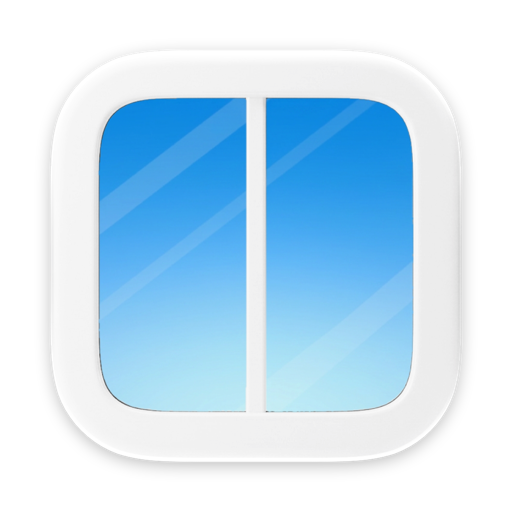

<div align="center">

<picture>
  <source media="(prefers-color-scheme: dark)" srcset=".github/assets/logo-dark.png" />
  
</picture>

<h3>Pane</h3>

<p><em>Every profile, its own internet.</em></p>

<p align="center">
  
  
  
</p>

<p align="center">
  <a href="https://github.com/andredezzy/pane/releases">Releases</a> ·
  <a href="https://github.com/andredezzy/pane/issues">Issues</a>
</p>

</div>

Pane is an Arc-inspired desktop browser for macOS — a sidebar-first browser where every profile is a fully isolated identity with its own session, proxy, fingerprint, and Chrome extensions. It is its own build of Chromium, and its interface is part of it, drawn in C++ with Views, Chromium's own toolkit, as Chrome's own is: one code path for every window, sheet, and dialog, which already compiles for Windows, where Pane doesn't run yet.

## Features

- **Session isolation** — cookies, storage, and cache are partitioned per profile; profiles never share data
- **Per-profile proxies** — each profile routes through its own HTTP, HTTPS, SOCKS4, or SOCKS5 proxy; authenticated SOCKS connections use a local relay
- **Browser fingerprinting** — configurable user agent and Client Hints, platform, WebGL, canvas noise, audio noise, screen, timezone, and locale per profile, applied inside the engine
- **Chrome extensions** — install from the Chrome Web Store per profile, with Chrome's own extension system and updates
- **Encrypted on disk** — every profile's tabs, cookies, site data, and caches, in a volume under a key the optional PIN releases, and every file a profile writes again under a key only Pane's processes hold
- **PIN lock with data wipe** — Pane locks at launch, on command, when the Mac sleeps or locks, and after a time without use; five consecutive failures at the lock relaunch Pane fresh, with the key gone and the data erased
- **Save history, per profile** — turned off, a profile keeps no record of its pages, their icons, or its downloads, and what it kept is cleared; it stays signed in
- **Memory that stays small** — idle tabs sleep, hidden profiles unload, and their caches are trimmed
- **Updates that install themselves** — Pane checks for a new release, downloads it when you say, and swaps it in as it quits

## Install

Pane needs macOS 14 or later on Apple Silicon.

1. Download `Pane-<version>-arm64.dmg` from the [latest release](https://github.com/andredezzy/pane/releases/latest).
2. Open it and drag Pane to Applications.
3. Open Pane. It is not notarized yet, so macOS stops it the first time, saying it could not verify Pane. Close that dialog, then choose Open Anyway in System Settings › Privacy & Security.

Updates need none of this: Pane installs them itself.

## Build from source

### Requirements

- macOS 14 or later on Apple Silicon, with Xcode (packaging compiles the icon and signs the bundle)
- Bun >= 1.3.9 (scenarios and linters)
- To change Pane's code, its UI included: a Chromium checkout (~100 GB; `docs/building.md`), since Pane builds as part of Chromium. To package what `main` already holds: the prebuilt engine its commit names.

### Build and run

```bash
git clone https://github.com/andredezzy/pane.git
cd pane
export PANE_ENGINE_OUT="$(scripts/fetch-engine.sh)"   # or build the engine: docs/building.md
scripts/package.sh                                    # → app/build/Pane.app
```

Until `main`'s first release, its Pane opens only a scenario's throwaway data (`bun tests/run.ts --binary app/build/Pane.app/Contents/MacOS/Pane …`), and the released app is built from the `swift` branch (AGENTS.md).

## Project structure

```text
pane/          # the //pane tree, Pane's code, linked into Pane Framework.framework: its UI in ui/, its data and rules in model/
chromium/      # what Pane does to Chromium: the pinned tag, gn args, patches, the engine archives' keys, UPGRADING.md
app/           # what packaging reads: VERSION, the icon and its sources, the dmg's resources, the entitlements
scripts/       # sync, build, patch, check, package, and publish the engine and the app
tests/         # the scenario runner: scenarios that drive the built app, and their fixtures
docs/          # building.md, human-checklist.md, adr/ (one record per subject), benchmarks/, growth/, qa/
third_party/   # the license and origin of each project Pane takes code from (NOTICE)
.github/       # CI: gates.yml (linters, the OS-flag check), release.yml (the dmg, on a v* tag), chromium-watch.yml (when Chrome's Mac stable moves)
```

## Scripts

```bash
bun install          # once: the linters, the typecheck, knip, and the migration scenario's Electron
bun run lint         # ESLint --fix + Biome check --write
bun run typecheck    # type-check the scenario runner
bun run test         # build and run pane_unittests, the engine's unit tests (a Chromium checkout)
bun run knip         # check for unused files, deps, and exports
```

Scenarios drive the packaged app (`docs/building.md`, Scenarios):

```bash
bun tests/run.ts --binary app/build/Pane.app/Contents/MacOS/Pane --out <dir> <scenario>...
```

To produce a distributable:

```bash
scripts/dist.sh    # dmg → app/release/Pane-<version>-arm64.dmg
```

Chromium upgrades follow `chromium/UPGRADING.md`.

## Security

Report vulnerabilities to contact@andredezzy.com.

[GPL-3.0](LICENSE) © [André Victor](https://github.com/andredezzy)

Pane is built on [Chromium](https://www.chromium.org/) (BSD-3-Clause and its components' licenses). Third-party origins and licenses are in `NOTICE` and `third_party/`; the packaged app carries them in `Contents/Resources/Licenses`.
