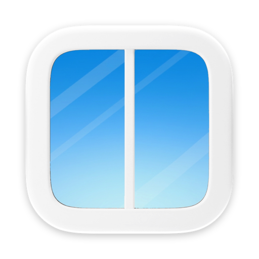

<div align="center">

<picture>
  <source media="(prefers-color-scheme: dark)" srcset=".github/assets/logo-dark.png" />
  
</picture>

<h3>Pane</h3>

<p><em>Every profile, its own internet.</em></p>

<p align="center">
  
  
  
</p>

<p align="center">
  <a href="https://github.com/andredezzy/pane/releases">Releases</a> ·
  <a href="https://github.com/andredezzy/pane/issues">Issues</a>
</p>

</div>

Pane is an Arc-inspired desktop browser for macOS — a sidebar-first browser where every profile is a fully isolated identity with its own session, proxy, fingerprint, and Chrome extensions. Like Arc and Dia, it is a native app (Swift, AppKit and SwiftUI) on its own build of Chromium, embedded in the same process.

## Features

- **Session isolation** — cookies, storage, and cache are partitioned per profile; profiles never share data
- **Per-profile proxies** — each profile routes through its own HTTP, HTTPS, SOCKS4, or SOCKS5 proxy; authenticated SOCKS connections use a local relay
- **Browser fingerprinting** — configurable user agent and Client Hints, platform, WebGL, canvas noise, audio noise, screen, timezone, and locale per profile, applied inside the engine
- **Chrome extensions** — install from the Chrome Web Store per profile, with Chrome's own extension system and updates
- **PIN lock with data wipe** — optional bcrypt-hashed PIN; five consecutive failures relaunch Pane fresh and overwrite all profile data in 3 random passes
- **Memory that stays small** — idle tabs sleep, hidden profiles unload, and their caches are trimmed

## Getting started

### Requirements

- macOS 14 or later on Apple Silicon, Xcode with Swift 6, and [XcodeGen](https://github.com/yonaskolb/XcodeGen)
- Bun >= 1.3.9 (scenarios and linters)
- To build the engine yourself: a Chromium checkout (~100 GB; `docs/building.md`). Otherwise the app builds on a prebuilt engine.

### Build and run

```bash
git clone https://github.com/andredezzy/pane.git
cd pane
export PANE_ENGINE_OUT="$(engine/scripts/fetch-engine.sh)"   # or build the engine: docs/building.md
engine/scripts/package.sh                                    # → app/build/Pane.app
open app/build/Pane.app
```

## Project structure

```text
app/           # the Swift app (AppKit + SwiftUI), the PaneKit package, VERSION, dmg resources
engine/        # PaneCore.framework: the pinned Chromium tag, gn args, patches, //pane, scripts
tests/         # the scenario runner: scenarios that drive the built app, and their fixtures
docs/          # building.md, human-checklist.md, adr/ (one record per decision), benchmarks/
third_party/   # the license and origin of each project Pane takes code from (NOTICE)
.github/       # CI: gates.yml (linters), app.yml (tests and build), release.yml (the dmg, on a v* tag)
```

## Scripts

```bash
bun install          # once: the linters, the typecheck, knip, and the migration scenario's Electron
bun run lint         # ESLint --fix + Biome check --write
bun run typecheck    # type-check the scenario runner
bun run test         # PaneKit's tests (swift test)
bun run knip         # check for unused files, deps, and exports
```

Scenarios drive the packaged app (`docs/building.md`, Scenarios):

```bash
bun tests/run.ts --binary app/build/Pane.app/Contents/MacOS/Pane --out <dir> <scenario>...
```

To produce a distributable:

```bash
engine/scripts/dist.sh    # dmg → app/release/Pane-<version>-arm64.dmg
```

Chromium upgrades follow `engine/UPGRADING.md`.

## Security

Report vulnerabilities to contact@andredezzy.com.

[GPL-3.0](LICENSE) © [André Victor](https://github.com/andredezzy)

Pane is built on [Chromium](https://www.chromium.org/) (BSD-3-Clause and its components' licenses). Third-party origins and licenses are in `NOTICE` and `third_party/`; the packaged app carries them in `Contents/Resources/Licenses`.
